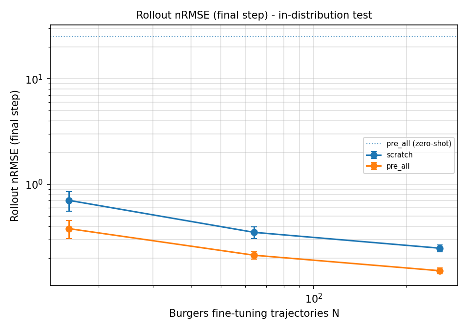
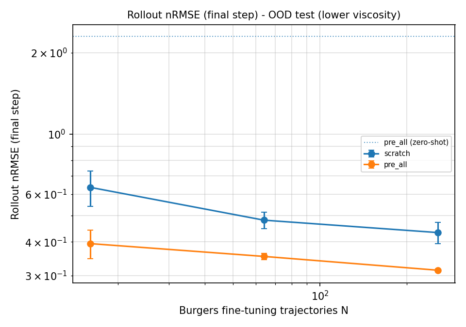
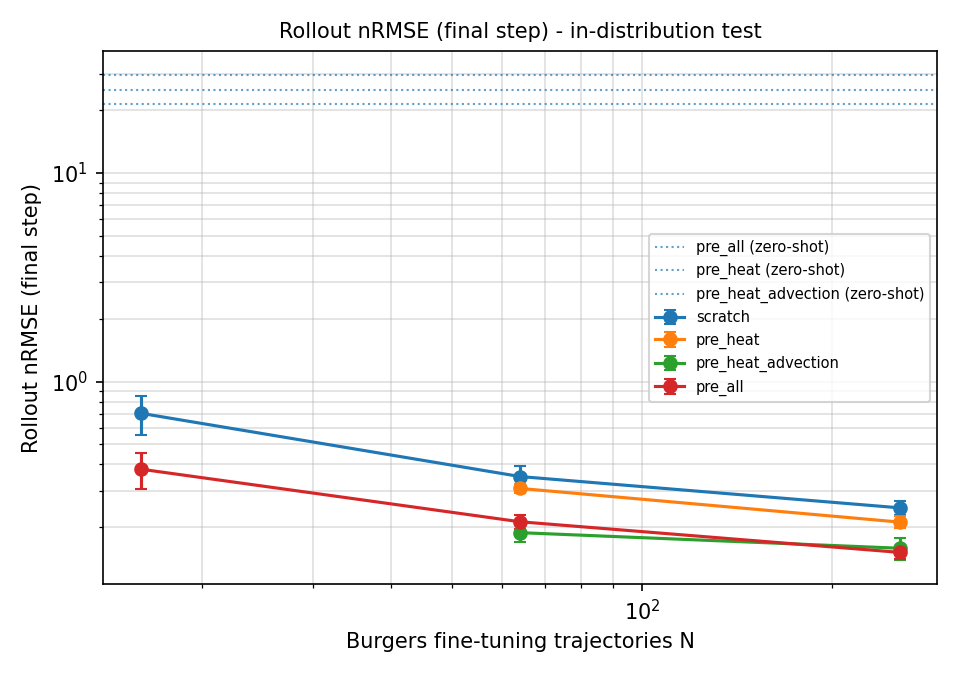

# Multi-PDE Pretraining and Transfer with a Fourier Neural Operator (toy scale)

**Question.** If one neural operator is pretrained on several PDE families, does it adapt to a
*held-out* PDE with fewer examples than the same network trained from scratch?

This is a small, controlled study of pretraining, fine-tuning and transfer on 1D problems that run on a
single laptop GPU (RTX 4050, 6 GB). It is **not** a foundation model: it uses a 0.55M-parameter network,
four hand-written 1D solvers and at most 114,000 pretraining transitions.

## Summary of findings (3 seeds, fine-tuning on N = 16, 64, 256 Burgers trajectories)

* **Pretraining helps under equal budgets.** Pretraining on heat, advection and reaction-diffusion lowers
  the rollout error on held-out Burgers by 46% (N=16), 39% (N=64) and 39% (N=256);
  one-step error falls by 64%, 55% and 51%.
* **Part of that gap is training budget.** Giving the from-scratch model 3x more steps lowers its rollout error
  by 14% (N=64) and 23% (N=256). Against that longer-trained scratch model, pretraining still
  lowers rollout error by 30% (N=64) and 21% (N=256).
* **The out-of-distribution gain is smaller.** On lower-viscosity Burgers (sharper shocks than any fine-tuning
  trajectory) the equal-budget gain is 38% (N=16) and about 27% (N=64 and N=256), and only 10% (N=64) and
  8% (N=256) against the longer-trained scratch model.
* **Advection was the key pretraining ingredient.** Adding advection to heat lowers rollout error by
  39% (N=64) and 25% (N=256). Adding reaction-diffusion on top gave no clear further gain.
* **Zero-shot transfer fails.** Without fine-tuning, the pretrained models predict the next Burgers step with
  moderate error (one-step nRMSE about 0.03-0.04) but their autoregressive rollouts diverge (nRMSE 20-30).

## Setup

| Family | Equation | Role | Solver |
|---|---|---|---|
| heat | u_t = nu u_xx | pretraining | exact (Fourier) |
| advection | u_t + c u_x = 0 | pretraining | exact (Fourier) |
| reaction_diffusion | u_t = nu u_xx + r u (1 - u) | pretraining | Strang splitting with exact sub-steps |
| burgers | u_t + u u_x = nu u_xx | **held out** (fine-tuning / testing) | pseudo-spectral, integrating-factor RK4 |

* Periodic domain [0, 1), 128 grid points, 21 snapshots at t = 0, 0.05, ..., 1.0. Coefficients are drawn
  at random per trajectory (ranges in `data.py`).
* In-distribution test: Burgers with nu in [0.03, 0.08]. **OOD test**: nu in [0.01, 0.03) (lower viscosity).
* Model (`model.py`): FNO-1D (width 64, 16 modes, 4 layers, 549,633 parameters). Input = the two previous
  states and the grid coordinate; output = the next state (residual increment). The model is **not** told which
  PDE or which coefficients: the two-frame history is its only information.
* Pretraining: 2,000 trajectories per family (heat only: 38,000 transitions; heat + advection: 76,000; all three:
  114,000), 8,000 steps, batch 128, AdamW with a cosine schedule.
* Metric: normalised RMSE, `||pred - true||_2 / ||true||_2`, averaged over samples. *One-step* is teacher-forced;
  *rollout* is autoregressive from the two true initial frames; "final step" is the last of 19 predicted frames.

## Fair-comparison protocol

* Every arm uses the same architecture, optimiser, schedule and fine-tuning budget (2,000 steps), and the same
  learning-rate grid {1e-3, 3e-4}; the best learning rate and checkpoint are chosen on the same validation set.
* The N training trajectories for a given (N, seed) are identical for all arms (the first N of a seeded permutation
  of a fixed pool of 1,024 simulated Burgers trajectories).
* Train, validation (32 trajectories) and test sets (200 + 200 OOD) come from different fixed seeds (checked in
  `tests/test_data.py`). No dataset statistics are used for normalisation.
* Caveat: for small N the validation set is larger than the training set, which gives *every* arm the same extra
  information.
* Results are mean ± standard deviation over 3 seeds (population std, `ddof=0`; the sample std is about 22% larger).
  Seeds change the training subset, the from-scratch initialisation and the batch order.

## Results





### Main result: pretrained vs from scratch (equal budget, 2,000 fine-tuning steps)

Rollout nRMSE, final step, in-distribution test:

| arm | N=16 | N=64 | N=256 |
|---|---|---|---|
| scratch | 0.705 ± 0.148 | 0.350 ± 0.044 | 0.248 ± 0.018 |
| pretrained (heat + advection + reaction-diffusion) | 0.380 ± 0.073 | 0.212 ± 0.017 | 0.151 ± 0.010 |

One-step nRMSE, in-distribution test:

| arm | N=16 | N=64 | N=256 |
|---|---|---|---|
| scratch | 0.0121 ± 0.0042 | 0.0056 ± 0.0009 | 0.0041 ± 0.0005 |
| pretrained | 0.0043 ± 0.0004 | 0.0025 ± 0.0001 | 0.0020 ± 0.0001 |

Rollout nRMSE, final step, OOD test (lower viscosity):

| arm | N=16 | N=64 | N=256 |
|---|---|---|---|
| scratch | 0.636 ± 0.096 | 0.481 ± 0.033 | 0.433 ± 0.038 |
| pretrained | 0.394 ± 0.048 | 0.353 ± 0.010 | 0.314 ± 0.003 |

One-step nRMSE, OOD test:

| arm | N=16 | N=64 | N=256 |
|---|---|---|---|
| scratch | 0.0405 ± 0.0120 | 0.0354 ± 0.0024 | 0.0326 ± 0.0011 |
| pretrained | 0.0242 ± 0.0039 | 0.0219 ± 0.0013 | 0.0193 ± 0.0006 |

### Controls: is the advantage an artefact of budget or learning rate?

Rollout nRMSE, final step (N=16 was not run for the controls):

| setting | in-dist. N=64 | in-dist. N=256 | OOD N=64 | OOD N=256 |
|---|---|---|---|---|
| scratch, 2,000 steps (main) | 0.350 ± 0.044 | 0.248 ± 0.018 | 0.481 ± 0.033 | 0.433 ± 0.038 |
| scratch, **6,000 steps** (lr 1e-3) | 0.302 ± 0.036 | 0.192 ± 0.029 | 0.393 ± 0.013 | 0.343 ± 0.015 |
| scratch, lr 3e-3, 2,000 steps | 0.317 ± 0.034 | 0.228 ± 0.016 | 0.436 ± 0.013 | 0.367 ± 0.015 |
| pretrained, 2,000 steps (main) | 0.212 ± 0.017 | 0.151 ± 0.010 | 0.353 ± 0.010 | 0.314 ± 0.003 |
| pretrained, lr 3e-3, 2,000 steps | 0.223 ± 0.007 | 0.164 ± 0.010 | 0.381 ± 0.007 | 0.326 ± 0.002 |

* A 3x larger budget improves the scratch model noticeably; the pretrained model keeps a clear in-distribution
  advantage, but the OOD advantage shrinks to about 8-10% (the gap is roughly 2 standard
  deviations at N=256 with 3 seeds).
* A higher learning rate (3e-3) helps scratch slightly and does not help the pretrained model. All main runs
  selected the top of the original learning-rate grid (1e-3), so the original grid was somewhat restrictive for
  scratch.
* **Not tested:** scratch with both the longer budget and the higher learning rate, and pretrained with a longer
  budget. The strongest possible scratch baseline is therefore not covered. The control files were compared
  using test metrics; within each run the learning rate and checkpoint were selected on validation data.

### Ablation: which pretraining families matter? (in-distribution rollout nRMSE, N=16 not run)

| pretraining on | N=64 | N=256 | OOD N=64 | OOD N=256 |
|---|---|---|---|---|
| nothing (scratch) | 0.350 ± 0.044 | 0.248 ± 0.018 | 0.481 ± 0.033 | 0.433 ± 0.038 |
| heat only | 0.307 ± 0.016 | 0.212 ± 0.014 | 0.397 ± 0.020 | 0.350 ± 0.003 |
| heat + advection | 0.188 ± 0.018 | 0.159 ± 0.019 | 0.357 ± 0.016 | 0.320 ± 0.008 |
| heat + advection + reaction-diffusion | 0.212 ± 0.017 | 0.151 ± 0.010 | 0.353 ± 0.010 | 0.314 ± 0.003 |

* Advection is the important addition, which fits Burgers being advection plus diffusion. Reaction-diffusion
  adds no clear gain (differences are within about one to two standard deviations).
* **Confound:** the three pretraining sets also differ in size (38k, 76k and 114k transitions), so family
  diversity and amount of data change together. This ablation therefore does not show that "more families"
  help, only that adding advection did.

Figures are written to `results/` by `plot_results.py` (for example
`results/main_test_rollout_nrmse_final.png`, `results/diversity_*`).

## Limitations

* 1D, periodic, smooth random initial conditions, one held-out PDE.
* Small network and small data; findings may not carry over to 2D/3D engineering problems or larger models.
* Only 3 seeds; most differences at N=16 are within noise, and the controls and the ablation were run only for
  N = 64 and 256.
* Burgers' nonlinear advection term appears in none of the pretraining families (reaction-diffusion is
  nonlinear only in the reaction).
* Rollout error accumulates; late-step errors are noisier for fast-decaying trajectories.
* An initial exploratory run also included N=1024 and a pretraining-set-size ablation; they were dropped for
  compute reasons and are not reported.

## Solver verification (`tests/`)

* Heat and advection match their exact solutions to about 1e-15.
* Reaction-diffusion with a constant state follows the logistic ODE exactly and stays in [0, 1].
* Burgers conserves the mean (1e-17), dissipates energy monotonically, and agrees with a 4x finer grid to about
  2e-5 (relative) at nu = 0.01, so the 128-point data are resolved in the whole viscosity range used.

## Reproduce

```bash
pip install -r requirements.txt
pytest -q                                   # solver and data tests (no GPU needed)

# main result
python run_pretrain.py --name pre_all --pdes heat advection reaction_diffusion
python run_transfer.py --ckpts pre_all
python plot_results.py --arms scratch pre_all --out-prefix results/main

# controls and diversity ablation, in small resumable chunks (pauses while the GPU is hot)
bash run_chunked.sh controls
bash run_chunked.sh diversity
bash run_chunked.sh plots
```

Results are appended to `results/transfer_results.json` after every run, so an interrupted sweep resumes where
it stopped. Keep `ckpt/`, `results/` and `data_cache/` when updating the code.

## Files

```
pdes.py            solvers and random initial conditions
data.py            dataset generation, caching, seeds, parameter ranges
model.py           FNO-1D
train.py           training loop and evaluation (shared by all arms)
run_pretrain.py    pretraining on a mixture of families
run_transfer.py    fine-tuning sweep: scratch vs pretrained
plot_results.py    figures and markdown tables
run_chunked.sh     controls, diversity ablation and plots in resumable chunks
run_all.sh         the full set of experiments in one go
tests/             solver and dataset tests
```

## License

MIT
